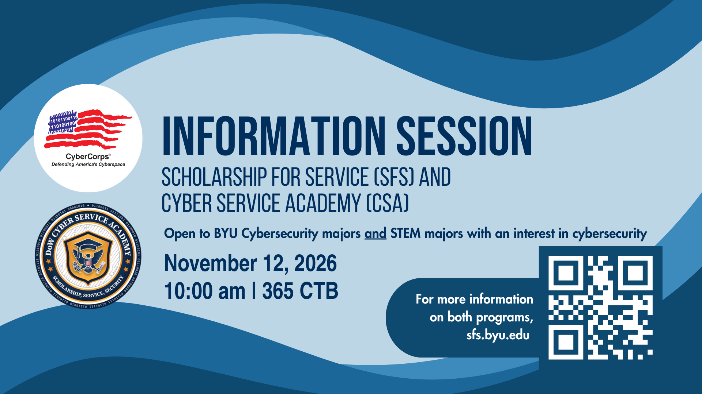

* Lab 5A due **Today!**
* HW6, UML Sequence Diagrams for lab 5 is due **Friday**.
    * Refer to S26 slides and video for details of UML sequence diagrams.
    * Consider using [https://sequencediagram.org](https://sequencediagram.org)
* I have updated the auto-scorer for HW1 (yes, way back at the beginning of the semester). Many have improved grades and there are comments when you didn't get a score right.

